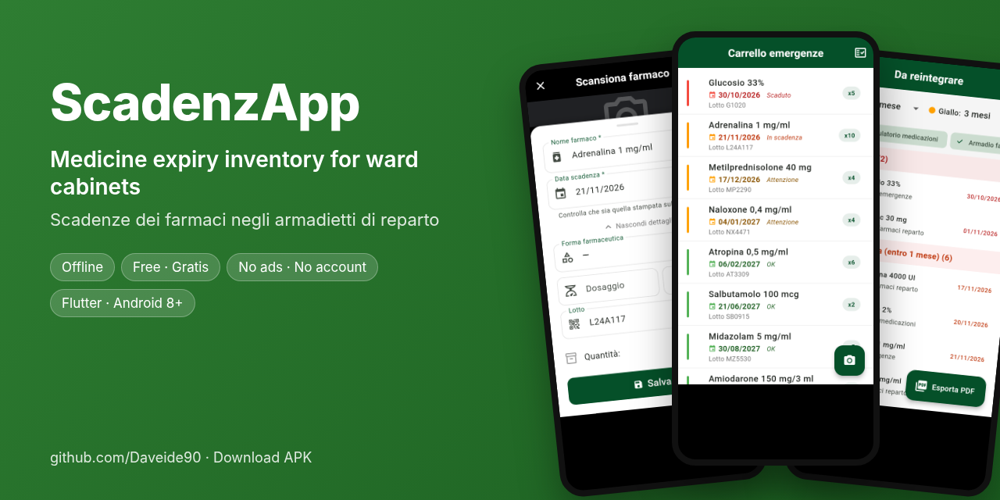
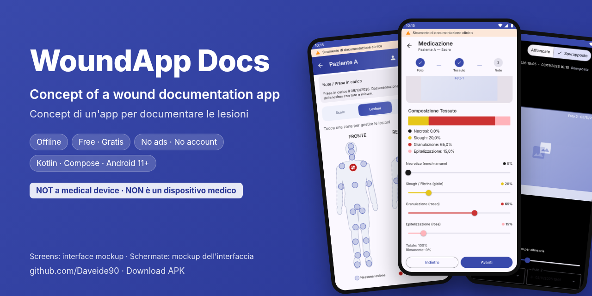
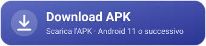
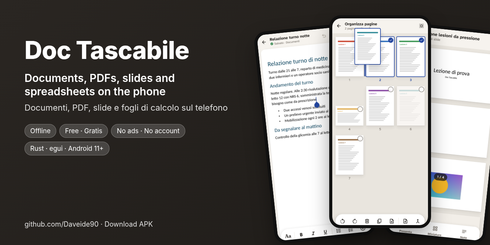
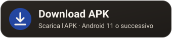

<h1 align="center">DavDev</h1>

<b>Android apps that keep your data on your phone, designed with AI</b> App Android che tengono i dati sul telefono, progettate con l'IA

**English.** I am not a professional software developer: I am an enthusiast, and I design and build Android apps for healthcare workers and for everyday work. I write them with the help of AI tools (Claude, by Anthropic), and I play an active role in their architecture, features, project direction, design and technical review. Every app works offline, with no account, no ads and no tracking. Each one was secure by design, hardened as far as I could and tested with automated attacks by AI in several rounds: the details and the limits are on each page.

**Italiano.** Non sono un programmatore professionista ma un appassionato, e progetto e realizzo app Android per chi lavora in sanità e per il lavoro di tutti i giorni. Le scrivo con l'aiuto di strumenti di intelligenza artificiale (Claude, di Anthropic), e svolgo un ruolo attivo nell'architettura, nelle funzionalità, nella direzione del progetto, nel design e nel controllo tecnico. Ogni app funziona senza rete, senza account, senza pubblicità e senza tracciamento. Ognuna è nata sicura, è stata rinforzata finché ho potuto e messa alla prova con attacchi automatici di un'IA in più cicli: dettagli e limiti sono nella pagina di ciascuna.

<table>
<tr>
<td width="46%"></td>
<td>
<h3><a href="https://github.com/Daveide90/scadenzapp">ScadenzApp</a></h3>

Medicine expiry inventory for ward, clinic and care home cabinets: the camera reads expiry and batch, every cabinet shows in colour what expires.

<i>Inventario delle scadenze dei farmaci negli armadietti: la fotocamera legge scadenza e lotto, ogni armadietto mostra a colori cosa scade.</i>

</td>
</tr>
<tr>
<td width="46%"></td>
<td>
<h3><a href="https://github.com/Daveide90/woundapp-docs">WoundApp Docs</a></h3>

A concept of how a wound documentation app should be: body map, photos, measurements, dressings and scale scores, encrypted on the phone. <b>Not a medical device.</b>

<i>Un concept di come dovrebbe essere un'app per documentare le lesioni: mappa corporea, foto, misure, medicazioni e punteggi, cifrati sul telefono. <b>Non è un dispositivo medico.</b></i>

</td>
</tr>
<tr>
<td width="46%"></td>
<td>
<h3><a href="https://github.com/Daveide90/doc-tascabile">Doc Tascabile</a></h3>

Documents, PDFs, slides and spreadsheets on the phone, written in Rust: write, fill in, sign, annotate, scan, present.

<i>Documenti, PDF, slide e fogli di calcolo sul telefono, scritto in Rust: scrivere, compilare, firmare, annotare, scansionare, presentare.</i>

</td>
</tr>
</table>

Free apps, offered as they are, without warranty. ScadenzApp and WoundApp Docs: free for the individual healthcare professional, who uses them under their own responsibility, not for hospitals, clinics or other organisations; Doc Tascabile: PolyForm Noncommercial licence. If an app is useful to you, a ☆ on its page helps. · App gratuite, offerte così come sono, senza garanzie. ScadenzApp e WoundApp Docs: gratuite per il singolo professionista sanitario, che le usa sotto la propria responsabilità, non per ospedali, cliniche o altre strutture; Doc Tascabile: licenza PolyForm Noncommercial. Se un'app ti è utile, una ☆ sulla sua pagina aiuta.
